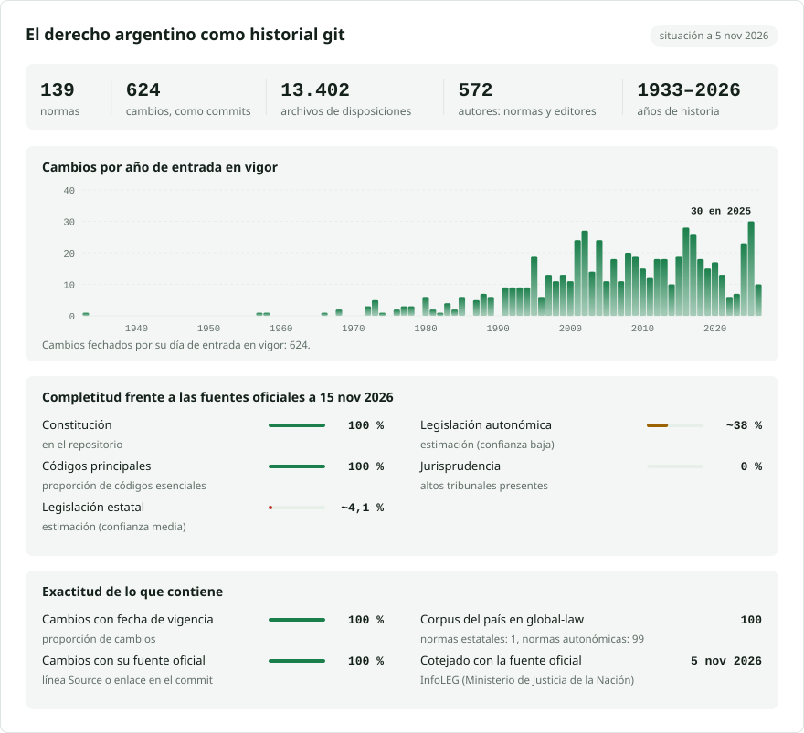

# Argentina: historia del derecho en git

**Español** · [English](README.en.md)

<picture>
<source media="(prefers-color-scheme: dark)" srcset="data/es/effort-dark.svg">

</picture>

El derecho nacional de la Argentina como historia de git: un archivo por artículo, un commit por norma el día en que entró en vigencia, y la ley o el decreto que hizo cada cambio como autor del commit. `git blame` indica la ley que está detrás de cada párrafo; `git log` enumera todos los cambios de un artículo; al elegir una fecha se obtiene el texto vigente ese día.

Forma parte de [lexifina/global-law](https://github.com/lexifina/global-law), una única historia de git para el derecho de todos los países: este es el derecho nacional de la Argentina, que global-law lee en `argentina/national/acts/`.

**Qué contiene ahora:** la Constitución y 138 códigos y leyes nacionales, entre ellos el Código Civil y Comercial, el Código Penal y la Ley de Contrato de Trabajo, con 775 versiones vigentes desde 1933 hasta 2026; 7 de esas leyes fueron derogadas después, y su historia termina con una versión sin disposiciones. Otras 6 versiones, que entrarán en vigencia más adelante, están en la rama `futuro`. [`data/versions.json`](data/versions.json) enumera cada norma con el día en que entró en vigencia cada versión; [`data/laws.csv`](data/laws.csv) enumera todas las normas que el registro menciona, con sus fechas.

Cada norma es una carpeta con su nombre (`ley-20744/`, `codigo-civil-y-comercial/`), con un archivo por artículo: `ley-20744/art-245.md` es el art. 245 de la Ley de Contrato de Trabajo (Ley 20.744, texto ordenado 1976). Las cuatro normas tomadas de Argentina.gob.ar son un solo archivo cada una, `texto.md`. El `README.md` de cada carpeta enumera sus disposiciones y cuándo cambió cada una.

El texto está en español, tal como lo publica InfoLEG (o Argentina.gob.ar), sin las notas de InfoLEG. InfoLEG conserva solo dos textos de cada norma, el texto original y el texto actualizado de hoy, por lo que las versiones intermedias se reconstruyen aplicando las instrucciones publicadas por cada norma modificatoria, en el orden de su entrada en vigencia.

## Preguntas como comandos de git

| Pregunta | Comando |
| --- | --- |
| Todos los cambios del art. 245 de la Ley de Contrato de Trabajo | `git log -p --word-diff -- ley-20744/art-245.md` |
| ¿Qué ley escribió cada párrafo del art. 245? | `git blame ley-20744/art-245.md` |
| Todas las versiones de la Ley de Contrato de Trabajo, con el día en que entró en vigencia cada una | `git log --format="%h %(trailers:key=In-force,valueonly,separator=) %an" -- ley-20744 ":^ley-20744/README.md"` |
| El art. 245 vigente al 1 de enero de 2023 | `python tools/en_vigor_el.py 2023-01-01 ley-20744 245` |

**Fuera de git**, también alojamos este registro de forma pública y gratuita:

- **[Preguntar a Claude sobre el derecho argentino](https://global-law.lexifina.com/v1/try_claude?country=argentina)**: abre Claude con una primera pregunta preparada.
- **[Preguntar a ChatGPT](https://global-law.lexifina.com/v1/try_chatgpt?country=argentina)**: la misma pregunta en ChatGPT.
- **[Buscar en el derecho argentino en nuestro sitio](https://lexifina.com/law?country=argentina&q=vacaciones+anuales)**: una búsqueda de "vacaciones anuales", con el texto de cada disposición y sus versiones, sin necesidad de cuenta.
- **[API REST para desarrolladores](https://global-law.lexifina.com/v1/search_law?query=vacaciones+anuales&jurisdiction=argentina)**: la misma búsqueda en JSON, sin clave. Consulte la [documentación aquí](https://lexifina.com/api/global-law).

Ambos asistentes leen el registro a través del conector gratuito Global law (MCP, `https://global-law.lexifina.com/mcp`); la primera vez, el chat le da el enlace para agregarlo. Pregunte en español o en inglés.

**Alójelo usted mismo fácilmente.** Solo hacen falta git y Python, y las herramientas se ejecutan en su equipo:

```sh
git clone --depth 1 https://github.com/lexifina/global-law && cd global-law
python3 tools/countries.py add argentina/national/acts
python3 tools/law.py show 2026-01-01 argentina/national/acts/ley-20744/art-245.md
```

Abierto en Claude Code, Cursor, VS Code o Codex, el clon también inicia un servidor MCP local con las mismas herramientas ([MCP.md](https://github.com/lexifina/global-law/blob/main/MCP.md)).

## Fechas

Cada commit está fechado a las doce del mediodía, hora de America/Argentina/Buenos_Aires, del día en que el cambio entró en vigencia, y lleva ese día en su trailer `In-force:`, junto a `Enacted:` y `Published:` (el día del Boletín Oficial):

- decide la cláusula de vigencia de la propia norma ("a partir del día siguiente al de su publicación"); a falta de ella, el art. 5 del Código Civil y Comercial ("Las leyes rigen después del octavo día de su publicación oficial"), computado según su art. 6, la sitúa en el noveno día posterior a la publicación; antes del 1 de agosto de 2015 la misma regla era el art. 2 del Código Civil, sustituido por la Ley 16.504;
- las entradas en vigencia escalonadas, las prórrogas y los plazos que vencen (el Código Procesal Penal Federal, distrito por distrito; la emergencia de la Ley 25.561) son commits que no cambian ninguna palabra, cada uno en su propio día;
- git no puede almacenar fechas anteriores a 1970, por lo que los 6 commits anteriores están fechados a partir del 1970-01-01, con un segundo de diferencia entre sí, y llevan el día real en `In-force:`. Para consultar una fecha, use `tools/en_vigor_el.py`, no `git log --before`.

Cada cambio se atribuye a la ley o al decreto que lo hizo, con una dirección que no puede existir (`Ley 27.802 <ley-27802@infoleg.invalid>`; los decretos de necesidad y urgencia, como `DNU 70/2023`), de modo que `git blame` y `git log --author` indican leyes. Una primera versión tomada de un texto ordenado, de un texto actualizado o de una captura archivada se atribuye a quien la publica, InfoLEG (11 normas) o Argentina.gob.ar (4), como "versión más antigua disponible"; el committer es Lexifina.

## Cómo se verifica

- El texto reconstruido a hoy de cada norma que InfoLEG actualiza se compara, artículo por artículo, con el texto actualizado de InfoLEG del día de la descarga: 0 diferencias de redacción, salvo las pocas que enumera `REPRODUCE.md` (como "integral" en el art. 86 del Código Penal, que el Decreto 14/2021 vetó y que InfoLEG conserva con una nota). Las normas que parten de una captura de 2013 también se cotejaron con capturas posteriores (de 2014 a 2025).
- `tools/check_repo.py` vuelve a leer desde git cada versión el día en que entró en vigencia y el día anterior; ambas lecturas deben coincidir con el corpus, cuyo sha256 está en `data/corpus.sha256`: 781 versiones de 139 normas, 0 discrepancias ([`REPRODUCE.md`](REPRODUCE.md)).
- El mismo corpus produce los mismos hashes de commit (`tools/build.py`); `REPRODUCE.md` deja constancia de que todavía no se ha comparado una segunda compilación.
- La historia solo admite agregados (`tools/append.py`): no hay commits de fusión (merge) en `main`, ni fechas de commit que retrocedan, ni nada fechado en el futuro, y los trailers de todos los commits se analizan sin errores.

## Qué no muestra

- **Todo el derecho nacional.** Son 139 normas, no la totalidad de la legislación; no están aquí los decretos reglamentarios ni las resoluciones que solo complementan una norma, ni la jurisprudencia.
- **Los cambios anteriores a la primera versión de una norma**, que quedan dentro de ese primer commit: por ejemplo, la Constitución antes de 1994, la Ley de Contrato de Trabajo antes de 1976 y el Código Penal antes de 1985. InfoLEG no ofrece ningún texto más antiguo de los Códigos Procesales Civil y Comercial y Penal, de la Ley 24.522 ni del Código Aduanero, por lo que estos parten de capturas de 2013 de las páginas de InfoLEG, fechadas el día de la captura; de las Leyes 13.064, 17.671, 22.431 y 27.351 solo está el texto actual.
- **Los cambios que no tocan el texto**: las suspensiones, las medidas de emergencia, los fallos judiciales (como los referidos al capítulo laboral del DNU 70/2023) y los tratados con jerarquía constitucional no tienen commit.
- **Encabezados, notas y palabras vetadas.** No se conservan los encabezados de libros, títulos y capítulos, se eliminan las notas de InfoLEG y se omiten las palabras vetadas en la promulgación.
- **El derecho provincial y de la ciudad**, que está en sus propios repositorios (como [argentina-buenos-aires-law](https://github.com/lexifina/argentina-buenos-aires-law)), que global-law lee junto a este bajo `argentina/`.

## Fuentes

| Fuente | Tipo | Versiones anteriores | Notas |
| --- | --- | --- | --- |
| [InfoLEG](https://www.infoleg.gob.ar) (Ministerio de Justicia de la Nación) | Base de datos oficial de legislación nacional | no: el texto original y el texto actualizado de hoy | Los textos de cada norma y los textos propios de las normas modificatorias; sus notas indican la norma detrás de cada cambio |
| [Base de datos InfoLEG](https://datos.jus.gob.ar/dataset/base-de-datos-legislativos-infoleg) (datos.jus.gob.ar) | Conjunto de datos abiertos, CC BY 4.0 | no corresponde | El tipo, el número, las fechas y el título de cada norma |
| [Internet Archive Wayback Machine](https://web.archive.org/) | Capturas de las páginas de InfoLEG | sí, capturas fechadas desde 2013 | La primera versión de cuatro normas y los cotejos con capturas posteriores |
| [Argentina.gob.ar, Leyes Argentinas](https://www.argentina.gob.ar/normativa) (Ministerio de Justicia) | Legislación oficial | no, el texto actual | Leyes 13.064, 17.671, 22.431 y 27.351 |

## Licencia

Véase [`LICENSE`](LICENSE). Los textos normativos son textos oficiales de la Nación Argentina, reproducidos con la atribución "Fuente: InfoLEG - Información Legislativa, Ministerio de Justicia de la Nación (www.infoleg.gob.ar)"; las páginas de InfoLEG no publican ninguna licencia y la situación de los textos en materia de derecho de autor no está confirmada, mientras que el conjunto de datos InfoLEG (tipos, números, fechas y títulos de las normas) tiene licencia CC BY 4.0. Las contribuciones propias de Lexifina (la organización, los mensajes de commit, las tablas y las herramientas) son CC0 1.0.

Ningún modelo de IA escribió, tradujo ni corrigió texto normativo, y ninguno se ejecuta durante la compilación; los scripts los escribió Claude Code con Claude Opus 5.5 (véase [`REPRODUCE.md`](REPRODUCE.md)).

Esta es una traducción de la versión inglesa ([README.en.md](README.en.md)); si difieren, prevalece la versión inglesa.

## Más información

Del repositorio [lexifina/global-law](https://github.com/lexifina/global-law) (páginas en inglés):

- [FEATURES.md](https://github.com/lexifina/global-law/blob/main/FEATURES.md): todas las funciones y lo que cada corpus debe admitir (`git blame`, `law.py`, herramientas MCP)
- [FAQ.md](https://github.com/lexifina/global-law/blob/main/FAQ.md): preguntas y respuestas · [CONTRIBUTING.md](https://github.com/lexifina/global-law/blob/main/CONTRIBUTING.md): proponer cambios · [MCP.md](https://github.com/lexifina/global-law/blob/main/MCP.md): servidor MCP · [REPRODUCE.md](https://github.com/lexifina/global-law/blob/main/REPRODUCE.md): cómo se ha construido · [CHANGELOG.md](https://github.com/lexifina/global-law/blob/main/CHANGELOG.md)
- [FRESHNESS.md](https://github.com/lexifina/global-law/blob/main/FRESHNESS.md): lo actualizado que está cada corpus · [Supervisión](https://github.com/lexifina/global-law/tree/main/monitoring): si las actualizaciones funcionan · [WATCHING.md](https://github.com/lexifina/global-law/blob/main/WATCHING.md): cómo se vigila cada fuente oficial para detectar cambios
- [performance/](https://github.com/lexifina/global-law/tree/main/performance): la rapidez de las herramientas, medida
- [visualisations/](https://github.com/lexifina/global-law/tree/main/visualisations): gráficos y conexiones a través del derecho de todo el mundo
- [Vulnerabilidades](https://github.com/lexifina/global-law/tree/main/vulnerabilities): errores en las normas tal como se publicaron
